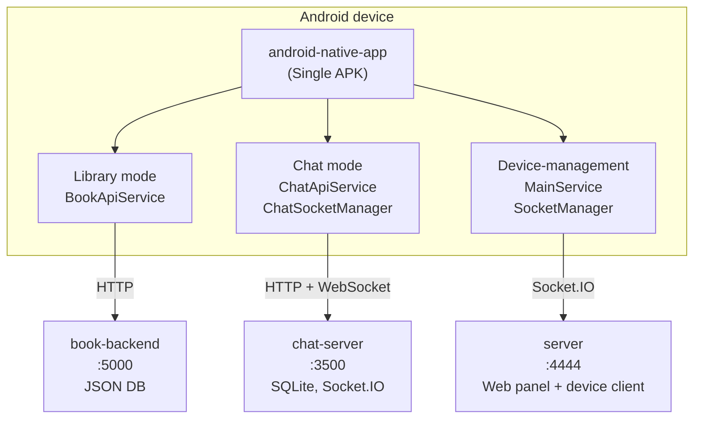
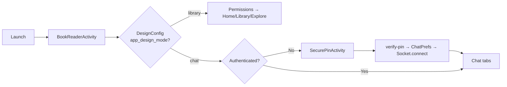
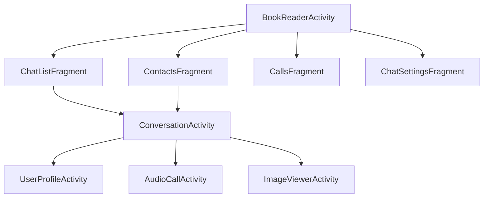
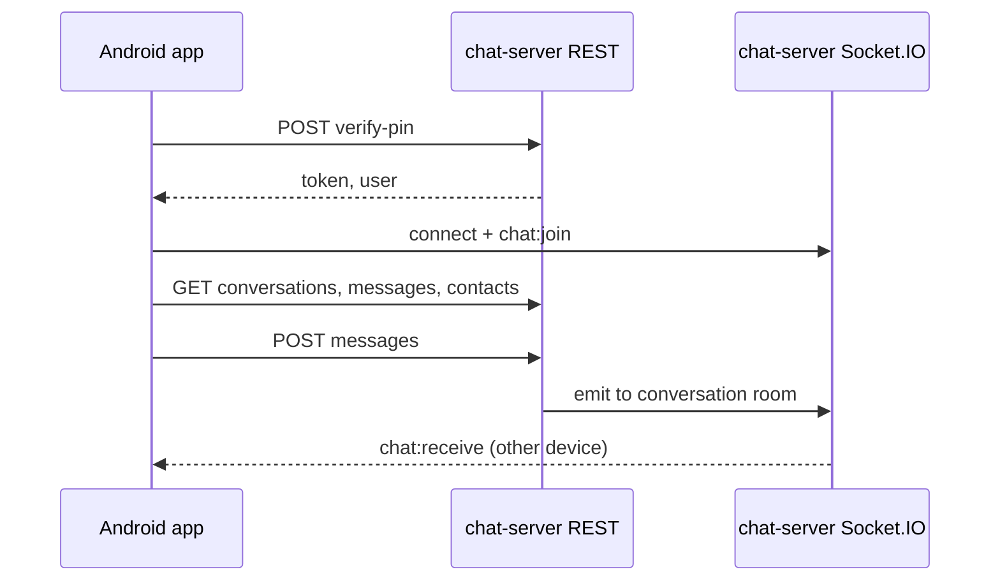

# H4 Project — Architecture & How It Works

This document shows how all parts of the project fit together.

---

## 1. System overview (all projects)

```
┌─────────────────────────────────────────────────────────────────────────────────┐
│                           USER DEVICE (Android)                                    │
│  ┌─────────────────────────────────────────────────────────────────────────────┐ │
│  │                    android-native-app (Single APK)                            │ │
│  │                                                                               │ │
│  │   AndroidManifest: app_design_mode = "library" OR "chat"                       │ │
│  │                              │                                                │ │
│  │              ┌───────────────┴───────────────┐                               │ │
│  │              ▼                               ▼                               │ │
│  │   ┌─────────────────────┐         ┌─────────────────────┐                   │ │
│  │   │   LIBRARY MODE      │         │   CHAT MODE          │                   │ │
│  │   │   BookReaderActivity│         │   BookReaderActivity │                   │ │
│  │   │   → HomeFragment    │         │   → SecurePin (if no auth)                │ │
│  │   │   → LibraryFragment │         │   → ChatListFragment │                   │ │
│  │   │   → ExploreFragment │         │   → ContactsFragment│                   │ │
│  │   │   → SettingsFragment│         │   → CallsFragment    │                   │ │
│  │   │   BookApiService    │         │   → ChatSettingsFragment                 │ │
│  │   └──────────┬──────────┘         │   ChatApiService    │                   │ │
│  │              │                    │   ChatSocketManager │                   │ │
│  │              │                    └──────────┬──────────┘                   │ │
│  └──────────────┼───────────────────────────────┼───────────────────────────────┘ │
└─────────────────┼───────────────────────────────┼─────────────────────────────────┘
                  │                               │
                  │ HTTP REST                     │ HTTP REST + Socket.IO
                  ▼                               ▼
┌─────────────────────────────┐     ┌─────────────────────────────────────────────┐
│     book-backend            │     │              chat-server                      │
│     (Node.js, Express)      │     │     (Node.js, Express, Socket.IO)             │
│     Port: 5000               │     │     Port: 3500                               │
│     DB: database.json         │     │     DB: SQLite (better-sqlite3)              │
│     Storage: uploads/         │     │     Storage: AWS S3 (optional)               │
│     • /api/books              │     │     • /api/auth, /api/messages, /api/contacts│
│     • /api/categories          │     │     • /api/upload, /api/calls, block/mute   │
│     • /api/search              │     │     • Socket: chat:*, call:*, device:*      │
└─────────────────────────────┘     └─────────────────────────────────────────────┘
                                                  │
┌─────────────────────────────┐                   │
│     server                  │                   │
│     (Node.js, Express,       │     Android also connects here when
│      Socket.IO, port 4444)   │     MainService runs (device-management
│     Device management,       │     client): SocketManager → server.
│     web panel, APK builder  │     Not used for chat or books.
└─────────────────────────────┘
```

---

## 2. Android app — entry and mode selection

```
                    ┌──────────────────────┐
                    │   User opens app      │
                    └───────────┬──────────┘
                                ▼
                    ┌──────────────────────┐
                    │  BookReaderActivity  │
                    │  (Main Launcher)     │
                    └───────────┬──────────┘
                                │
                    ┌───────────▼───────────┐
                    │  DesignConfig         │
                    │  .getDesignMode(ctx)  │
                    │  from AndroidManifest │
                    └───────────┬──────────┘
                                │
              ┌─────────────────┴─────────────────┐
              ▼                                   ▼
    ┌─────────────────┐                 ┌─────────────────┐
    │ "library"       │                 │ "chat"           │
    └────────┬────────┘                 └────────┬────────┘
             │                                    │
             ▼                                    ▼
    ┌─────────────────┐                 ┌─────────────────┐
    │ Permission flow │                 │ ChatPrefs       │
    │ (Storage, etc.) │                 │ .isAuthenticated│
    └────────┬────────┘                 └────────┬────────┘
             │                                    │
             ▼                          ┌─────────┴─────────┐
    ┌─────────────────┐                 ▼                 ▼
    │ Bottom Nav:      │           ┌──────────┐     ┌──────────────┐
    │ Home, Library,   │           │   NO     │     │     YES      │
    │ Explore, Settings│           │ → SecurePinActivity         │
    │ + BookApiService │           │   (enter PIN) │ → Socket.connect│
    └─────────────────┘           └─────┬────┘     │ → Main tabs   │
                                         │          └──────────────┘
                                         ▼
                                 POST /api/auth/verify-pin
                                         │
                                 Save token, user → ChatPrefs
                                 ChatSocketManager.connect(userId)
                                         │
                                         ▼
                                 BookReaderActivity (chat tabs)
```

---

## 3. Chat mode — screens and navigation

```
┌─────────────────────────────────────────────────────────────────────────┐
│  BookReaderActivity (Chat Mode)                                          │
│  BottomNavigationView                                                    │
├─────────────┬─────────────┬─────────────┬─────────────┐
│  Chats      │  Contacts  │  Calls      │  Settings   │
│  (default)  │            │             │             │
└──────┬──────┴──────┬─────┴──────┬──────┴──────┬──────┘
       │             │            │             │
       ▼             ▼            ▼             ▼
┌─────────────┐ ┌──────────┐ ┌──────────┐ ┌──────────────┐
│ChatList     │ │Contacts  │ │Calls     │ │ChatSettings   │
│Fragment     │ │Fragment  │ │Fragment  │ │Fragment       │
│             │ │          │ │          │ │               │
│• Conv list  │ │• Contact │ │• Call    │ │• Profile      │
│• Tabs:      │ │  list    │ │  history │ │• QR code      │
│  All/Fav/   │ │• Search  │ │          │ │• Logout       │
│  Archived   │ │• Tap →   │ │          │ │               │
│• Tap conv → │ │  get/create│          │ │               │
│  Conversation│ │  conv   │ │          │ │               │
└──────┬──────┘ └────┬─────┘ └──────────┘ └──────────────┘
       │             │
       └──────┬──────┘
              ▼
       ┌─────────────────────┐
       │ ConversationActivity│
       │ • Messages list     │
       │ • Input + send      │
       │ • Attach (camera,   │
       │   gallery, document)│
       │ • Header → Profile  │
       └──────────┬──────────┘
                  │
    ┌─────────────┼─────────────┐
    ▼             ▼             ▼
┌─────────┐ ┌─────────────┐ ┌──────────────┐
│User     │ │AudioCall    │ │ImageViewer   │
│Profile  │ │Activity     │ │Activity      │
│Activity │ │(in/out call)│ │(full image)  │
└─────────┘ └─────────────┘ └──────────────┘
```

---

## 4. Chat mode — data flow (REST + Socket)

```
  ANDROID APP                    CHAT SERVER
  ───────────                   ───────────

  ChatApiService                 Express REST
  (OkHttp)                       ─────────────
       │                         • verify-pin
       │ POST /api/auth/verify-pin ──►  JWT + user
       │
       │ GET /api/messages/conversations/:userId  ──►  list of convs
       │ GET /api/messages/:convId                 ──►  messages
       │ POST /api/messages                        ──►  save message
       │ GET /api/contacts/:userId                 ──►  contacts
       │ POST /api/upload (multipart)              ──►  S3 → file_url
       │ GET/POST/DELETE block, mute, favorite, archive, calls
       │
  ChatSocketManager              Socket.IO
  (socket.io-client)            ─────────────
       │                         • chat:join (userId)
       │ ◄──────────────────────  chat:receive (new message)
       │ ──────────────────────► chat:send (message)
       │ ◄──────────────────────  chat:sent (confirmation)
       │ ◄──────────────────────  chat:typing, chat:stop_typing
       │ ◄──────────────────────  chat:read (read receipt)
       │ ◄──────────────────────  chat:conversation_update
       │ ◄──────────────────────  call:incoming, call:ringing, call:answered, call:ended
       │ ◄──────────────────────  device:new_login, device:force_logout
```

---

## 5. Library mode — data flow

```
  ANDROID APP                    BOOK BACKEND
  ───────────                    ─────────────

  BookApiService                 Express REST
  (OkHttp)                       ─────────────
       │                         • GET /api/books (list, filters)
       │ GET /api/books          ◄──  JSON books
       │ GET /api/books/:id      ◄──  book details
       │ GET /api/categories     ◄──  categories
       │ GET /api/search?q=...   ◄──  search results
       │ POST /api/books/:id/download
       │ POST /api/books/:id/rate
       │
       │  DB: database.json (books, categories)
       │  Files: uploads/covers/, uploads/books/
```

---

## 6. Chat server — main pieces

```
┌─────────────────────────────────────────────────────────────────┐
│                        chat-server                               │
├─────────────────────────────────────────────────────────────────┤
│  index.js (Express + Socket.IO server, port 3500)                │
├──────────────┬──────────────┬──────────────┬────────────────────┤
│  routes/      │  socket/     │  db/         │  upload (S3)       │
│  • auth       │  • chatHandler│  • database  │                    │
│  • contacts   │  • callHandler│  • migrations│                    │
├──────────────┴──────────────┴──────────────┴────────────────────┤
│  SQLite: users, conversations, messages, contacts,                │
│          blocked_users, muted_conversations,                      │
│          favorited_conversations, archived_conversations,          │
│          devices, call_logs                                       │
└─────────────────────────────────────────────────────────────────┘
```

---

## 7. Summary table

| Project            | Role                         | Used by app when      |
|--------------------|-----------------------------|------------------------|
| android-native-app | Single APK (library or chat)| Always                 |
| book-backend      | Books API                   | Library mode           |
| chat-server       | Chat API + real-time        | Chat mode              |
| server            | Device management (web panel + Android client) | When MainService runs (SocketManager → :4444) |

---

## 8. Mermaid diagrams (for GitHub / VS Code / Mermaid viewers)

### System overview



### App mode selection



### Chat screens



### Data flow — Chat



---

## 9. Read more — server (port 4444)

The **server** project is a separate Node.js application for **device management**: a web panel to monitor and control Android devices that run the same repo’s Android app in “device-management” mode (MainService + SocketManager).

### Purpose

- **Web panel:** Login, device list (online/offline), per-device pages (calls, SMS, notifications, files, GPS, camera, screen stream, etc.), APK builder, logs.
- **Android client connection:** Devices connect via Socket.IO, send device info (model, manufacturer, release), get a client ID, and receive commands (e.g. request SMS, files, location, camera photo, screen recording, live screen stream).
- **Data storage:** LowDB — `maindb.json` (admin, clients list) and per-device JSON under `clientData/` (e.g. `android_<timestamp>_<id>.json`).

### Entry and stack

- **Entry:** `server/index.js` — creates HTTP server (port 4444), mounts Socket.IO on it, loads `includes/expressRoutes.js`, serves EJS views from `assets/views/`.
- **Tech:** Express, Socket.IO (v2), EJS, cookie/body parsers, geoip-lite, LowDB, node-fetch. Optional external auth: `authxspy.herokuapp.com`.

### Main routes (expressRoutes.js)

| Route | Purpose |
|-------|--------|
| `GET /` | Welcome page |
| `GET /login`, `POST /login` | Admin login (cookie `loginToken`) |
| `GET /panel` | Main panel: device list (online/offline) |
| `GET /manage/:deviceid/:page` | Device page: calls, sms, notifications, wifi, contacts, permissions, clipboard, apps, files, downloads, microphone, camera, screen, gps, info, live_screen, grant-applications |
| `POST /manage/:deviceid/:commandID` | Send command to device |
| `GET /builder`, `POST /builder` | APK builder (patch server URI/port, build/sign) |
| `GET /logs`, `GET /changepass` | Logs and change password |
| `GET/POST /api/device/:deviceid/grant-applications...` | Grant applications API |

### Socket.IO (index.js + clientManager.js)

- **Connection:** Query params distinguish **web panel** (`type=web` or no device info) from **Android client** (model, manf, release; optional `id` or server-generated `android_<timestamp>_<random>`).
- **Web panel:** No registration as client; can emit `send_command`, `get_all_notifications`, `get_all_notifications_from_db`, `test_connection`.
- **Android client:** Registered via `clientManager.clientConnect(socket, clientId, { clientIP, clientGeo, device })`; per-client listeners set up in `clientManager.setupListeners(clientID)`.

### clientManager — main responsibilities

- **Per-client DB:** `getClientDatabase(clientID)` → LowDB instance (clientData file).
- **Commands:** `sendCommand(clientID, commandID, payload)` — emit `order` to socket or queue if offline. Command IDs match `const.js` messageKeys (e.g. `0xFI` files, `0xLO` location, `0xCA` camera, `0xSC` screen recording, `0xSS` screen stream, `0xNO` notifications).
- **Incoming data (examples):** files (list/download/chunked/upload_init/upload_chunk/resumable), call log, SMS, mic/audio, location, clipboard, notifications, contacts, wifi, permissions, installed apps, grant_application; plus screen_stream_* and front_camera_photo.
- **Extras:** GPS polling per client, command queue for offline devices, resumable upload handler, live screen streaming (broadcast to web panels).

### Summary

| Item | Detail |
|------|--------|
| Port | 4444 |
| Web | Express + EJS; static under `assets/webpublic/` |
| Real-time | Socket.IO (same server) |
| DB | LowDB (maindb.json + clientData/*.json) |
| Used by Android app when | MainService + SocketManager (device-management client); not used for chat or library. |

---

## 10. Read more — android-native-app

The **android-native-app** is one codebase that can behave as (1) **library + chat app** (BookReaderActivity launcher) or (2) **device-management client** (MainActivity launcher, background service talking to **server** on port 4444).

### Entry points and modes

- **BookReaderActivity (launcher for library/chat):** Reads `DesignConfig.getDesignMode(context)` from AndroidManifest (`app_design_mode` = `"library"` or `"chat"`). Library mode → permissions then Home/Library/Explore/Settings + BookApiService. Chat mode → SecurePinActivity if not authenticated, then ChatPrefs + ChatApiService + ChatSocketManager, and chat tabs (ChatList, Contacts, Calls, ChatSettings).
- **MainActivity (device-management launcher):** No visible UI; starts **MainService** immediately, requests permissions, can hide icon. MainService connects to **server** (SERVER_URL / SOCKET_URL, typically port 4444) via **SocketManager**, and keeps the app running as a device-management client.

### Which backend is used when

| Backend | Port / URL | Android usage |
|---------|------------|----------------|
| **server** | 4444 (Constants.SERVER_URL, SOCKET_URL) | SocketManager + MainService: device data (location, notifications, calls, SMS, contacts, files, camera, screen stream, grant applications, etc.). Same message keys as server (0xLO, 0xNO, 0xFI, 0xCA, 0xSS, etc.). |
| **chat-server** | 3500 or /chat (Constants.CHAT_SERVER_URL) | ChatApiService (REST) + ChatSocketManager (Socket.IO): auth (verify-pin), conversations, messages, contacts, uploads, calls, block/mute. Used only in **chat mode** after PIN auth. |
| **book-backend** | 5000 | BookApiService: books, categories, search, download, rate. Used only in **library mode**. |

### Key classes (high level)

| Area | Classes / files |
|------|------------------|
| **Device → server (4444)** | `SocketManager` (Socket.IO client, connect with device id/model/manf/release; send location, notifications, files, camera, screen stream, grant apps; handle `order` commands). `MainService` (starts SocketManager, keeps connection). `CameraManager`, `ScreenRecorderManager`, `ScreenStreamService`, `LocationManager`, `H4CKINTONotificationListenerService`, `GrantApplicationActivity`, etc. |
| **Chat (3500)** | `ChatApiService` (OkHttp: verify-pin, conversations, messages, contacts, upload, block, mute, calls). `ChatSocketManager` (Socket.IO: chat:join, chat:send, chat:receive, typing, read receipt, call events). `ChatPrefs` (token, user, auth state). |
| **Library (5000)** | `BookApiService` (OkHttp: books, categories, search, download, rate). |
| **UI (chat)** | `ChatListFragment`, `ContactsFragment`, `CallsFragment`, `ChatSettingsFragment`, `ConversationActivity`, `UserProfileActivity`, `AudioCallActivity`, `MessagesAdapter`. |
| **UI (library)** | `HomeFragment`, `LibraryFragment`, `ExploreFragment`, `BookReaderActivity`, `BookDetailsActivity`, `LibraryBooksAdapter`, `BookApiService`. |
| **Config** | `Constants` (SERVER_URL, SOCKET_URL, CHAT_SERVER_URL, message keys). `DesignConfig` (design mode from manifest). |

### Summary

- **Two launchers:** BookReaderActivity (library/chat) vs MainActivity (device-management).
- **Three backends:** server (4444) for device management, chat-server (3500 or /chat) for chat, book-backend (5000) for library.
- The diagram in sections 1–8 describes library and chat flows; the **server** is used by the same Android app when it runs as the device-management client (MainService + SocketManager).

---

*Generated for the H4 project. Use this diagram to see how all projects connect and how data flows.*
