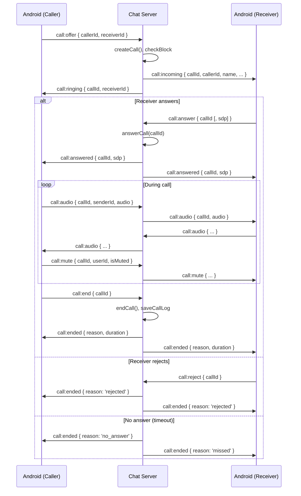

# How Calls Work — Android App & Chat Server

This document describes how **voice calls** work between the **android-native-app** and the **chat-server**, with flow diagrams.

---

## Overview (WebRTC P2P)

- **Signaling**: Socket.IO on the chat server (same connection as chat). Server only forwards SDP (offer/answer) and ICE candidates; it does **not** relay audio.
- **Audio**: WebRTC peer-to-peer (RTCPeerConnection, AudioTrack, STUN). Low latency, scalable; server CPU is not used for media.
- **State**: Call state (ringing, active, ended) is kept in **callService** (in-memory `activeCalls` Map). Call logs are stored in the database via REST.

---

## 1. High-Level Architecture

```
┌─────────────────────┐         Socket.IO (chat server)         ┌─────────────────────┐
│   Android App       │◄──────────────────────────────────────►│   Chat Server        │
│   (Caller/Receiver) │   call:offer, call:answer, call:audio    │   callHandler.js     │
│                     │   call:incoming, call:ringing, etc.      │   callService.js     │
└─────────────────────┘                                          └──────────┬──────────┘
                                                                             │
                                                                             │ REST
                                                                             ▼
                                                                   GET/DELETE /api/calls/:userId
                                                                   (call logs)
```

---

## 2. Socket.IO Rooms

- When a user connects, the **chat** handler runs `chat:join` and does `socket.join('user_' + userId)`.
- The **call** handler uses the same `io` instance, so it can target users with:
  - `io.to('user_' + receiverId).emit('call:incoming', ...)`
  - `io.to('user_' + callerId).emit('call:ended', ...)`
- So **call** and **chat** share the same Socket.IO connection and room naming (`user_<userId>`).

---

## 3. Call Flow (Sequence)

### 3.1 Outgoing call (Caller starts call)

```
  ANDROID (Caller)              CHAT SERVER                     ANDROID (Receiver)
  ─────────────────             ───────────                    ───────────────────

  User taps "Call"
       │
       │  AudioCallActivity
       │  createOutgoing(...)
       │  initiateCall()
       │
       │  emit "call:offer"
       │  { callerId, receiverId }
       │─────────────────────────►
       │                          │  callHandler: call:offer
       │                          │  - checkBlock(caller, receiver)
       │                          │  - callService.createCall(callerId, receiverId)
       │                          │  - activeCalls.set(callId, { callerId, receiverId, status: 'ringing' })
       │                          │
       │                          │  io.to('user_'+receiverId).emit('call:incoming', { callId, callerId, ... })
       │                          │────────────────────────────────────────────────────────►
       │                          │                              │  ChatSocketManager
       │                          │                              │  on("call:incoming")
       │                          │                              │  → OnCallListener.onIncomingCall()
       │                          │                              │  → BookReaderActivity launches
       │                          │                              │     AudioCallActivity.createIncoming()
       │                          │
       │  socket.emit('call:ringing', { callId, receiverId })
       │◄─────────────────────────
       │  OnCallListener.onCallRinging()
       │  UI: "Ringing..."
       │
       │  (optional) setCallTimeout(45s) → if no answer:
       │  caller gets 'call:ended' reason 'no_answer'
       │  receiver gets 'call:ended' reason 'missed'
```

### 3.2 Incoming call (Receiver answers or rejects)

```
  ANDROID (Receiver)              CHAT SERVER                     ANDROID (Caller)
  ─────────────────             ───────────                    ─────────────────

  Incoming screen shows
  [Answer] [Reject]
       │
       │  Answer:
       │  emit "call:answer"
       │  { callId [, sdp] }
       │─────────────────────────►
       │                          │  callService.answerCall(callId)
       │                          │  - status = 'active', startTime = now
       │                          │  - clear timeout
       │                          │  io.to('user_'+callerId).emit('call:answered', { callId, sdp })
       │                          │  io.to('user_'+receiverId).emit('call:answered', { callId, sdp })
       │                          │────────────────────────────────────────────────────────►
       │  startActiveCall()       │◄────────────────────────────────────────────────────────
       │  - AudioStreamManager    │
       │    startCapture()       │  OnCallListener.onCallAnswered()
       │    startPlayback()       │  startActiveCall() → timer, capture, playback
       │  - send call:audio       │
       │  - receive call:audio    │
       │
       │  Reject:
       │  emit "call:reject" { callId }
       │─────────────────────────►
       │                          │  callService.rejectCall(callId)
       │                          │  saveCallLog(..., 'rejected', 0)
       │                          │  io.to(caller).emit('call:ended', reason: 'rejected')
       │                          │  io.to(receiver).emit('call:ended', reason: 'rejected')
       │                          │────────────────────────────────────────────────────────►
       │  finish()                │  OnCallListener.onCallEnded() → stopCall(), finish()
```

### 3.3 Active call (audio + mute + end)

```
  USER A                         CHAT SERVER                     USER B
  ──────                         ───────────                     ──────

  AudioStreamManager
  captures PCM → base64
       │
       │  emit "call:audio"
       │  { callId, senderId, audio }
       │─────────────────────────►
       │                          │  callService.getCall(callId), status === 'active'
       │                          │  targetId = other side
       │                          │  io.to('user_'+targetId).emit('call:audio', { callId, audio })
       │                          │────────────────────────────────────────────────────────►
       │                          │                              │  OnCallListener.onCallAudio()
       │                          │                              │  audioStream.playChunk(base64)
       │
       │  emit "call:mute" { callId, userId, isMuted }
       │─────────────────────────►
       │                          │  io.to(other).emit('call:mute', ...)
       │                          │────────────────────────────────────────────────────────►
       │                          │                              │  UI: show mute indicator
       │
       │  User taps End
       │  emit "call:end" { callId }
       │─────────────────────────►
       │                          │  callService.endCall(callId)
       │                          │  - duration, saveCallLog(callerId, receiverId, 'completed', duration)
       │                          │  io.to(caller).emit('call:ended', { callId, reason: 'ended', duration })
       │                          │  io.to(receiver).emit('call:ended', { callId, reason: 'ended', duration })
       │◄─────────────────────────
       │  OnCallListener.onCallEnded() → stopCall(), finish()
       │                          │────────────────────────────────────────────────────────►
       │                          │                              │  OnCallListener.onCallEnded() → stopCall(), finish()
```

---

## 4. Server-Side Events (chat-server)

| Event (client → server) | Handler (callHandler.js) | Action |
|-------------------------|---------------------------|--------|
| **call:offer**          | call:offer                | createCall, emit call:incoming to receiver, call:ringing to caller, set 45s timeout |
| **call:answer**         | call:answer               | answerCall(callId), emit call:answered to both (with optional SDP) |
| **call:reject**         | call:reject               | rejectCall(callId), emit call:ended (rejected) to both |
| **call:end**            | call:end                  | endCall(callId), save log, emit call:ended (ended, duration) to both |
| **call:ice-candidate**  | call:ice-candidate        | relay ICE candidate to the other peer (WebRTC) |
| **call:audio**          | call:audio                | relay base64 audio to the other peer (PCM streaming) |
| **call:mute**           | call:mute                 | relay mute state to the other peer |
| **disconnect**          | disconnect                | cleanupUserCalls(userId), emit call:ended (disconnected) to other side |

---

## 5. Server → Client Events (Android ChatSocketManager)

| Server emits             | Android listener / action |
|--------------------------|----------------------------|
| **call:incoming**        | OnCallListener.onIncomingCall() → launch AudioCallActivity (e.g. from BookReaderActivity) |
| **call:ringing**         | OnCallListener.onCallRinging() → UI "Ringing..." (caller) |
| **call:answered**       | OnCallListener.onCallAnswered() → startActiveCall() (timer, capture, playback) |
| **call:ended**          | OnCallListener.onCallEnded() → stopCall(), finish() |
| **call:audio**          | OnCallListener.onCallAudio() → AudioStreamManager.playChunk(base64) |
| **call:mute**            | OnCallListener.onCallMute() → show/hide mute indicator |

---

## 6. Call State (callService.js)

```
                    createCall()
  ┌──────────────►  status: 'ringing'
  │                 startTime: null
  │                 timeoutHandle: 45s
  │
  │  answerCall()           rejectCall() / timeout / endCall()
  │  ─────────────►        ─────────────────────────────────►  (call removed)
  │  status: 'active'
  │  startTime = now
  │  timeout cleared
  │
  │  endCall()
  └──────────────────────►  saveCallLog(), delete from activeCalls
```

---

## 7. REST API (call logs)

- **GET /api/calls/:userId** — returns call history for the user (from DB).
- **DELETE /api/calls/:userId** — deletes all call logs for the user.

Used by the Android app to show the Calls tab and clear history.

---

## 8. Android Components

| Component               | Role |
|-------------------------|------|
| **AudioCallActivity**  | Single screen for incoming/outgoing call; initiates offer, answer, reject, end; sends call:audio and call:mute; plays received call:audio. |
| **ChatSocketManager**  | Holds Socket.IO connection; emits call:offer/answer/reject/end/audio/mute; registers OnCallListener; receives call:incoming, call:ringing, call:answered, call:ended, call:audio, call:mute. |
| **AudioStreamManager**  | Captures microphone → base64 chunks; plays base64 chunks to speaker; mute/speaker. |
| **CallsFragment**       | Shows call log (from REST); tap to start outgoing call via AudioCallActivity.createOutgoing(). |
| **ConversationActivity** / **UserProfileActivity** | Call button → AudioCallActivity.createOutgoing(). |
| **BookReaderActivity** | Global OnCallListener; onIncomingCall() → AudioCallActivity.createIncoming(). |

---

## 9. Mermaid Diagram (full flow)



---

## 10. File Reference

| Layer        | File(s) |
|-------------|---------|
| **Chat server – call socket** | `chat-server/socket/callHandler.js` |
| **Chat server – call state & log** | `chat-server/services/callService.js` |
| **Chat server – REST call logs** | `chat-server/routes/calls.js` |
| **Android – call UI** | `android-native-app/.../ui/AudioCallActivity.java` |
| **Android – socket & call listeners** | `android-native-app/.../network/ChatSocketManager.java` |
| **Android – audio capture/playback** | `android-native-app/.../utils/AudioStreamManager.java` (referenced from AudioCallActivity) |
| **Android – call list & outgoing** | `android-native-app/.../ui/fragments/CallsFragment.java` |
| **Android – incoming call launcher** | `android-native-app/.../ui/BookReaderActivity.java` (OnCallListener → createIncoming) |

---

This is the complete method-by-method and event-by-event description of how calls work between the Android app and the chat server, with drawings in ASCII and Mermaid.
